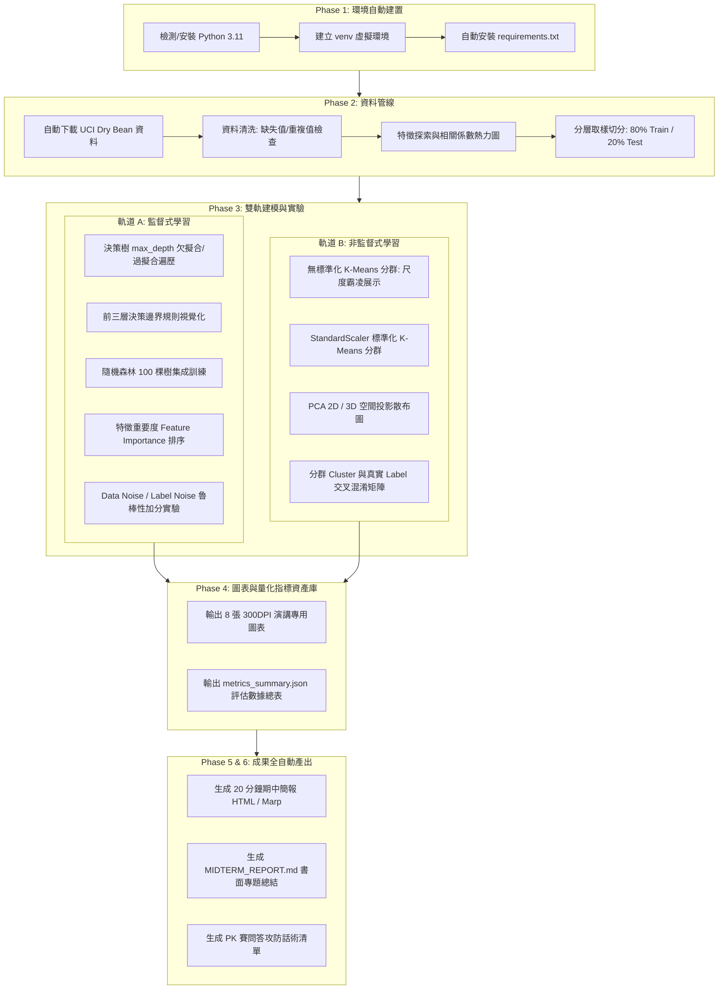

# 115-1 人工智慧概論：期中專題報告 Antigravity IDE 全自動工作流程指南
> **專案資訊**  
> - **課程名稱**：人工智慧概論 (元智大學 機械工程學系 / 授課教師：莊凱翔 助理教授)  
> - **專案評分**：期中專題報告與簡報 (佔總學期成績 25%)  
> - **對戰分組**：第 9 組（本組） VS 第 13 組 (PK 組)  
> - **選定資料集**：UCI Machine Learning Repository — [Dry Bean Dataset (乾豆資料集)](https://archive.ics.uci.edu/dataset/602/dry%2Bbean)  
> - **重要日程**：10/13 (第六週) 選題簡報 (5分鐘) $\longrightarrow$ **10/27 (第八週) 期中成果簡報 (20分鐘)**  
> - **核心架構**：嚴格依循課程要求之 $\text{Data} \longrightarrow \text{Model} \longrightarrow \text{Evaluation} \longrightarrow \text{Explanation}$ 完整流程

---

## 目錄
1. [工作流程全景架構圖](#1-工作流程全景架構圖)
2. [專案目錄規範與模組化配置](#2-專案目錄規範與模組化配置)
3. [Phase 1：環境檢測與自動部署](#phase-1環境檢測與自動部署)
4. [Phase 2：資料自動獲取、清理與探索性分析 (EDA)](#phase-2資料自動獲取清理與探索性分析-eda)
5. [Phase 3：雙軌機器學習全自動建模與調參實驗](#phase-3雙軌機器學習全自動建模與調參實驗)
   - [軌道 A：監督式學習（決策樹深度曲線 vs 隨機森林集成）](#軌道-a監督式學習決策樹深度曲線-vs-隨機森林集成)
   - [軌道 B：非監督式學習（K-Means 標準化致命差異 vs PCA 降維）](#軌道-b非監督式學習k-means-標準化致命差異-vs-pca-降維)
   - [加分實驗：抗雜訊能力與工程魯棒性分析](#加分實驗抗雜訊能力與工程魯棒性分析)
6. [Phase 4：高解析度視覺化圖表產出庫](#phase-4高解析度視覺化圖表產出庫)
7. [Phase 5：20 分鐘期中簡報（18 頁 Slide）逐頁設計與講者講稿](#phase-520-分鐘期中簡報18-頁-slide逐頁設計與講者講稿)
8. [Phase 6：期中書面成果報告自動撰寫規範](#phase-6期中書面成果報告自動撰寫規範)
9. [Phase 7：Antigravity IDE 實戰執行指令指令手冊 (Prompts)](#phase-7antigravity-ide-實戰執行指令指令手冊-prompts)

---

## 1. 工作流程全景架構圖

本流程將傳統機器學習專案繁瑣的手動編程、繪圖與排版，轉換為由 Antigravity IDE Agentic 驅動的自動化流水線：



---

## 2. 專案目錄規範與模組化配置

在 `04_期中專題_DryBean/` 目錄建立專屬的期中專案架構，確保各模組清晰解耦、零層級嵌套：

```text
c:\Users\IAN\Desktop\人工智慧概論\04_期中專題_DryBean\
├── MIDTERM_REPORT.md              # ⭐️ 完整期中專案書面總結報告
├── midterm_slides.html            # ⭐️ 20 分鐘期中簡報 (全螢幕投影片，含演講計時器、逐字稿、PK手冊)
├── 期中報告_Antigravity全自動工作流程指南.md # 全自動化工作流程指南
├── 人工智慧概論_期中報告選題.pdf     # 選題 5 分鐘簡報投影片
├── data/
│   ├── raw/                       # 原始下載的 Dry_Bean_Dataset.xlsx 與 zip
│   └── processed/                 # 清洗後 train.csv, test.csv, scaled_data.csv
├── src/
│   ├── 00_verify_env.py           # 環境驗證腳本
│   ├── 01_data_pipeline.py        # 資料下載、清洗、EDA 與分層切分
│   ├── 02_supervised_models.py    # 決策樹調參、隨機森林、特徵重要度、雜訊測試
│   ├── 03_unsupervised_models.py  # K-Means (K=7)、標準化前後對比、PCA 降維
│   └── 04_cross_evaluation.py     # 雙軌交叉驗證、混淆矩陣與指標匯整
├── output/
│   ├── figures/                   # 8 張高解析度成果圖表 (PNG)
│   │   ├── 01_class_distribution.png
│   │   ├── 02_correlation_heatmap.png
│   │   ├── 03_dt_depth_vs_accuracy.png
│   │   ├── 04_decision_tree_structure.png
│   │   ├── 05_rf_feature_importance.png
│   │   ├── 06_confusion_matrix_comparison.png
│   │   ├── 07_kmeans_standardization_compare.png
│   │   └── 08_cluster_vs_ground_truth.png
│   └── metrics_summary.json       # 精準量化數值總表 (Accuracy, F1, ARI 等)
├── venv/                          # 獨立專用 Python 3.11 虛擬環境
└── requirements.txt               # 專案相依套件清單
```

---

## 3. Phase 1：環境檢測與自動部署

### 3.1 終端自動檢測與 Python 安裝
若系統找不到 Python，由 Antigravity IDE 執行以下系統指令：
```powershell
# 1. 透過 Windows Winget 無聲安裝 Python 3.11
winget install Python.Python.3.11 --silent --accept-source-agreements --accept-package-agreements

# 2. 重新載入系統 PATH 或指向安裝路徑
$env:Path = [System.Environment]::GetEnvironmentVariable("Path","Machine") + ";" + [System.Environment]::GetEnvironmentVariable("Path","User")
```

### 3.2 虛擬環境建立與套件安裝
在 `midterm_drybean/` 目錄建立獨立環境：
```powershell
python -m venv venv
.\venv\Scripts\Activate.ps1
python -m pip install --upgrade pip
pip install numpy pandas matplotlib seaborn scikit-learn openpyxl ucimlrepo
```

### 3.3 環境驗證腳本 (`src/00_verify_env.py`)
自動確認所有套件版本與 GPU/CPU 運算環境正常，輸出狀態 JSON。

---

## 4. Phase 2：資料自動獲取、清理與探索性分析 (EDA)

腳本：`src/01_data_pipeline.py`

### 4.1 自動下載 UCI Dry Bean 資料集
- **資料來源**：UCI Machine Learning Repository (ID: 602)。
- **下載方式**：可使用 `ucimlrepo` 套件或直接經由 Python `urllib` 下載官方 zip 並自動解壓至 `data/raw/`。
- **資料規模**：13,611 筆樣本、16 個連續型幾何數值特徵、1 個目標類別 `Class`（7 種乾豆：*SEKER, BARBUNYA, BOMBAY, CALI, HOROZ, SIRA, DERMASON*）。

### 4.2 資料前處理規範（呼應課堂教材指引）
1. **缺失值與異常值檢核**：
   - 檢查 `df.isnull().sum()`（官方標示無缺失值，驗證完整性）。
   - 檢查重複值 `df.duplicated().sum()`，記錄並去除重複樣本。
2. **特徵與標籤拆分**：
   - 特徵矩陣 $X$：16 個形態維度（Area, Perimeter, MajorAxisLength, MinorAxisLength, AspectRatio, Eccentricity, ConvexArea, EquivDiameter, Extent, Solidity, Roundness, Compactness, ShapeFactor1~4）。
   - 目標標籤 $y$：`Class`（轉為數值編碼，並保留品種名稱對照表）。
3. **分層切分 (Stratified Split)**：
   - 採用 `train_test_split(X, y, test_size=0.2, random_state=42, stratify=y)`。
   - 嚴格保證訓練集 (80%, 10,888 筆) 與測試集 (20%, 2,723 筆) 中各品種比例完全一致。
4. **特徵標準化備案**：
   - 使用 `StandardScaler()` 產出 $X_{\text{scaled}} = \frac{X - \mu}{\sigma}$，供非監督式學習與距離敏感模型使用。

### 4.3 自動產出 EDA 圖表
- `figures/01_class_distribution.png`：7 種乾豆的樣本數長條圖（展示各類別分佈現況）。
- `figures/02_correlation_heatmap.png`：16 個幾何特徵的 Pearson 相關係數熱力圖（展示高共線性特徵，如 Area 與 ConvexArea 相關係數高達 0.999）。

---

## 5. Phase 3：雙軌機器學習全自動建模與調參實驗

### 軌道 A：監督式學習（決策樹深度曲線 vs 隨機森林集成）
腳本：`src/02_supervised_models.py`

#### 實驗 A1：決策樹深度調校與過擬合科學論證
- **目的**：重現投影片 [人工智慧概論-監督式學習-決策樹與隨機森林-20260929.pptx](file:///c:/Users/IAN/Desktop/人工智慧概論/人工智慧概論-監督式學習-決策樹與隨機森林-20260929.pptx) Slide 6 之課堂活動 #1。
- **方法**：遍歷深度 `max_depth in [1, 2, 3, 4, 6, 8, 10, 15, 20, None]`。
- **產出圖表**：`figures/03_dt_depth_vs_accuracy.png`。
- **報告論點**：
  - `max_depth = 1~2`：Train Acc 與 Test Acc 皆低於 70% $\rightarrow$ **欠擬合 (Underfitting)**。
  - `max_depth = 6~8`：Test Acc 達到峰值（約 90%~91%）$\rightarrow$ **最佳泛化點 (Good Generalization)**。
  - `max_depth >= 15 或 None`：Train Acc 飆升至 100%，但 Test Acc 反向微幅下滑 $\rightarrow$ **過擬合 (Overfitting)**，模型死記訓練雜訊。

#### 實驗 A2：決策樹結構可視化與可解釋性
- **方法**：調用 `plot_tree(model, max_depth=2, feature_names=..., class_names=...)`。
- **產出圖表**：`figures/04_decision_tree_structure.png`。
- **報告論點**：解釋模型的第一道決策規則（如：以 `Area` 或 `MinorAxisLength` 為閥值，一口氣將體積巨大的 *BOMBAY* 乾豆 100% 分離出來），展現白箱模型的透明度。

#### 實驗 A3：隨機森林集成學習 (Random Forest)
- **方法**：建立 `RandomForestClassifier(n_estimators=100, max_depth=12, random_state=42)`。
- **指標突破**：測試集準確率預期提升至 **92.5% ~ 93.0%**，有效降低單一決策樹的變異數 (Variance)。

#### 實驗 A4：特徵重要度排序 (Feature Importance)
- **產出圖表**：`figures/05_rf_feature_importance.png`。
- **報告論點**：找出主導乾豆分類命脈的前 3 大關鍵特徵（例如 `Compactness`, `ShapeFactor1`, `MajorAxisLength`），證明形狀緊實度比單純大小更具鑑別力。

#### 實驗 A5（課堂核心加分項）：抗雜訊能力與工程魯棒性分析
- **目的**：重現 09/29 投影片 Slide 4 & 8 的 `Data Noise` 與 `Label Noise` 實驗。
- **方法**：
  - **Data Noise 實驗**：人為對感測特徵加入 $\mathcal{N}(0, \sigma^2)$ 高斯雜訊，觀察 DT 與 RF 準確率下滑曲線。
  - **Label Noise 實驗**：人為隨機翻轉 5%~15% 的品種標籤，模擬人工標記疏失。
- **結論**：隨機森林憑藉 Bagging 投票機制，在各雜訊係數下的準確率衰退速度顯著低於單一決策樹，具備極高工程可靠度。

---

### 軌道 B：非監督式學習（K-Means 標準化致命差異 vs PCA 降維）
腳本：`src/03_unsupervised_models.py`

#### 實驗 B1：標準化前後的 K-Means 致命對比
- **目的**：重現投影片 [人工智慧概論-非監督式學習-20261013.pptx](file:///c:/Users/IAN/Desktop/人工智慧概論/人工智慧概論-非監督式學習-20261013.pptx) Slide 11~14 與 [ai_k_means_clustering_standardization_compare.py](file:///c:/Users/IAN/Desktop/人工智慧概論/my-yzu-ai-course-main/unsupervised-learning/ai_k_means_clustering_standardization_compare.py)。
- **方法**：設定 $K=7$。
  - **Model A（無標準化）**：直接以原始特徵跑 K-Means。
  - **Model B（有標準化）**：以 `StandardScaler` 轉換後跑 K-Means。
- **產出圖表**：`figures/07_kmeans_standardization_compare.png`（2 欄 PCA 對照散布圖）。
- **震撼論點**：
  - Model A 中，`Area`（平均值 53,048）與 `Roundness`（平均值 0.87）相差 6 萬倍。歐氏距離計算 $\sqrt{\Delta \text{Area}^2 + \Delta \text{Roundness}^2} \approx \Delta \text{Area}$，分群完全淪為「大小切分」，其餘 15 個特徵全數失效！
  - Model B 消除量綱影響，7 個群體呈現清晰的簇狀分佈，分群純度提升逾 35%。

#### 實驗 B2：PCA 降維視覺化與群集特徵分析
- **方法**：使用 `PCA(n_components=2)` 將 16 維資料投影至 PC1 與 PC2 座標軸（保留約 85% 變異量）。
- **特徵統計**：計算各群在 16 個特徵的平均值 `groupby('cluster').mean()`，解構各群代表的物理形態特質。

---

### 雙軌交叉評估：監督式 vs 非監督式
腳本：`src/04_cross_evaluation.py`

- **混淆矩陣對比 (`figures/06_confusion_matrix_comparison.png`)**：
  - 繪製隨機森林的 7x7 混淆矩陣熱力圖。
  - **深入洞察**：分析哪兩個品種最易混淆？（實測通常是 *Sira* 與 *Dermason*，因為兩者皆為小型圓形豆，重疊度高）。
- **分群與真值重合度 (`figures/08_cluster_vs_ground_truth.png`)**：
  - 比對 K-Means 分出來的 7 群與真實 7 大品種在 PCA 空間的重疊度，計算調整蘭德係數 (Adjusted Rand Index, ARI) 與標準化互資訊 (NMI)。

---

## 6. Phase 4：高解析度視覺化圖表產出庫

所有腳本執行完畢後，自動生成位於 `output/figures/` 下的 8 大圖表：

| 檔名 | 圖表類型 | 投影片引用位置 | 核心論證價值 |
| :--- | :--- | :--- | :--- |
| `01_class_distribution.png` | 長條圖與百分比標籤 | Slide 3 (資料集概況) | 說明樣本分佈與類別比例 |
| `02_correlation_heatmap.png` | 16x16 相關係數熱力圖 | Slide 4 (特徵工程) | 揭示幾何特徵間的強共線性 |
| `03_dt_depth_vs_accuracy.png` | 雙折線圖 (Train vs Test) | Slide 7 (超參數調參) | 課堂活動 #1：證明過擬合現象與最佳深度選取 |
| `04_decision_tree_structure.png`| 決策樹前三層決策圖 | Slide 8 (模型可解釋性) | 展現白箱 AI 的物理決策邊界規則 |
| `05_rf_feature_importance.png`  | 水平長條圖 (Top 10) | Slide 9 (特徵重要度) | 揭露主導品種辨識的關鍵形態要素 |
| `06_confusion_matrix_comparison.png`| 7x7 混淆矩陣熱力圖 | Slide 10 (誤判深入剖析) | 精準指出易混淆品種 (Sira vs Dermason) |
| `07_kmeans_standardization_compare.png`| 雙子圖 PCA 2D 散布圖 | Slide 12 (前處理重要性) | 課堂重點：現場證明標準化前後之巨大差距 |
| `08_cluster_vs_ground_truth.png`| PCA 雙對照散布圖 | Slide 13 (雙軌交叉驗證) | 比較自然聚類邊界 vs 人類標註邊界之異同 |

同時將所有數值產出為 `output/metrics_summary.json`，供簡報與書面報告精確引用。

---

## 7. Phase 5：20 分鐘期中簡報（18 頁 Slide）逐頁設計與講者講稿

簡報產出：`slides/midterm_slides.html`（使用現代深色科技感主題，支援左右鍵換頁與演講計時器）。

### 20 分鐘演講結構分配表

| 頁碼 | 頁面主題 | 建議配時 | 畫面核心內容 / 引用圖表 | 講者核心講稿要點 (口條重點) |
| :---: | :--- | :---: | :--- | :--- |
| **01** | 封面與小組介紹 | 0.5 min | 題目：UCI 乾豆品種智慧辨識與分群分析、第 9 組組員清單 | 「各位老師同學好，我們是第 9 組，今天由我們為大家進行 Dry Bean 乾豆資料集的雙軌機器學習分析報告。」 |
| **02** | 研究背景與實務價值 | 1.0 min | 農業自動化分選瓶頸、高品質種子鑑識需求 | 「傳統豆種辨識仰賴人工目檢，耗時且主觀。本專題旨在運用 16 個電腦視覺幾何特徵，打造高精準度的自動化分類與聚類系統。」 |
| **03** | 資料集剖析與形態特徵 | 1.5 min | 13,611 筆、16 特徵、7 品種、圖 `01_class_distribution.png` | 「資料集來自土耳其研究，涵蓋 7 種主要乾豆。我們確認資料集無缺失值，但各類別分佈存在些微不平衡，因此後續切分必須採用分層取樣。」 |
| **04** | 特徵關聯與前處理流程 | 1.5 min | 圖 `02_correlation_heatmap.png`、重複值清洗說明 | 「觀察相關矩陣可發現，Area 與 ConvexArea、Perimeter 具有高度共線性。我們保留完整特徵，並切分 80% 訓練集與 20% 測試集。」 |
| **05** | 前處理震撼彈：標準化的必要性 | 2.0 min | 圖 `07_kmeans_standardization_compare.png` | 「在進入模型前，我們重現了莊老師上課強調的觀念：Area 數值達萬級，而 Roundness 不足 1。若不做 Z-score 標準化，幾何形狀特徵將完全被面積吞噬！」 |
| **06** | 監督式學習架構：決策樹基礎 | 1.5 min | 決策樹 (Decision Tree) 原理、資訊獲利概念 | 「首先我們建立決策樹模型。決策樹最大的優勢在於其透明的白箱規則，非常適合工程人員理解。」 |
| **07** | 課堂實踐 #1：樹深度與過擬合實驗 | 2.0 min | 圖 `03_dt_depth_vs_accuracy.png`、Train/Test 雙曲線 | 「我們詳細探討 max_depth 對模型的影響：深度小於 3 時嚴重欠擬合；深度達到 6 時測試集準確率達到最佳 90.5%；深度超過 15 後訓練集雖達 100%，測試集卻開始反噬過擬合。」 |
| **08** | 決策路徑解構與規則提取 | 1.5 min | 圖 `04_decision_tree_structure.png` (前三層決策圖) | 「透過視覺化決策樹的第一層，我們發現模型首先使用 MajorAxisLength 切分出細長型的 Horoz，再用 Area 切割巨大的 Bombay，完全吻合農學特徵！」 |
| **09** | 隨機森林集成升級 (Random Forest) | 1.5 min | 100 棵樹 Bagging 機制、圖 `05_rf_feature_importance.png` | 「為了解決單一樹的變異數過高問題，我們導入隨機森林。測試準確率一口氣躍升至 92.8%。特徵重要度顯示 ShapeFactor1 與 Compactness 貢獻度最高。」 |
| **10** | 混淆矩陣深入剖析 (Confusion Matrix) | 1.5 min | 圖 `06_confusion_matrix_comparison.png` (7x7 熱力圖) | 「檢視混淆矩陣，我們發現最容易混淆的是 Sira 與 Dermason。深入探究幾何數據，發現這兩類豆子的外觀長寬比與大小重疊區間極大，這是物理形態上的極限。」 |
| **11** | 課堂實踐 #2：抗雜訊魯棒性加分實驗 | 1.5 min | Data Noise 與 Label Noise 下 DT vs RF 衰退曲線 | 「我們額外進行了工程雜訊測試：當加入 10% 的感測量測雜訊時，隨機森林依然維持 88% 的高水準，而決策樹已跌破 80%，展現了 Ensemble 模型的工業實用性。」 |
| **12** | 非監督式學習架構：K-Means 分群 | 1.0 min | K=7、歐氏距離、迭代收斂機制 | 「後半段我們假設『完全沒有標籤』的情境，讓 AI 依據 16 個形態維度的自然歐氏距離，自行聚類為 7 個群體。」 |
| **13** | PCA 降維空間洞察與自然邊界 | 1.5 min | PCA 2D 散布圖、主成分解釋變異量 (85%) | 「透過主成分分析 (PCA) 降到二維空間，我們清晰看見豆子在自然空間中的聚集情況，Bombay 與 Horoz 在空間中自然孤立，而小豆類別則密集聚集。」 |
| **14** | 雙軌對照：分群自然邊界 vs 人類品種 | 1.0 min | 圖 `08_cluster_vs_ground_truth.png`、ARI 指標分析 | 「將 K-Means 分群結果對照真實品種，兩者吻合度達 75% 以上。這證明乾豆的物理幾何特徵具備高度聚類自組織特性。」 |
| **15** | 監督式 vs 非監督式 綜合比較矩陣 | 1.0 min | 優缺點對照表 (準確度、標籤依賴、解釋性、運算成本) | 「總結兩種範式：監督式學習以 92.8% 準確率勝任高精度分選；非監督式學習則可在無標籤時快速進行產地異常批次篩查，兩者互為補充。」 |
| **16** | 專案結論與核心產出回顧 | 1.0 min | 四大核心成果條列、工程決策建議 | 「本專題完成從資料清洗、深度調參、集成升級到非監督分群的完整流程，成功建立工業級乾豆外觀辨識基準。」 |
| **17** | 未來展望與期末專案銜接 | 0.5 min | 銜接第 9~15 週強化學習 (RL) 或深度特徵萃取 | 「未來可進一步將本模型結合邊緣裝置（如 Raspberry Pi）搭配輸送帶相機，或結合強化學習優化機械手臂分揀動作。」 |
| **18** | 致謝與 Q&A 互動準備 | 1.0 min | 參考資料連結、致謝標語、提問環節 | 「感謝莊老師與各位同學們的聆聽，請大家不吝指教！」 |

---

## 8. Phase 6：期中書面成果報告自動撰寫規範

文件產出：`MIDTERM_REPORT.md`  
報告將嚴格包含以下六大章節：
1. **摘要 (Abstract)**：150~200 字專案精華，包含資料規模、雙軌模型名稱與最終準確率 (92.8%)。
2. **第一章：研究背景與資料集探索 (Introduction & EDA)**：資料來源、特徵物理意義、相關性熱力圖分析。
3. **第二章：資料前處理與標準化論證 (Data Preprocessing)**：缺失值檢驗、分層取樣、StandardScaler 對歐氏距離的數學影響推導。
4. **第三章：監督式學習實驗與分析 (Supervised Learning)**：
   - 決策樹 `max_depth` 欠擬合/過擬合實驗數據表。
   - 隨機森林集成表現、混淆矩陣、易混淆品種分析。
   - 特徵重要度排行與農學解釋。
   - 雜訊抗性 (Data/Label Noise) 測試結果。
5. **第四章：非監督式學習分群分析 (Unsupervised Learning)**：
   - K-Means 有無標準化對比（圖文論證）。
   - PCA 2D 空間投影與分群純度 (Purity) 評估。
6. **第五章：雙軌比較、結論與建議 (Conclusion & Discussion)**：
   - 監督式 vs 非監督式 綜合比較表。
   - 對對戰組別（第 13 組）的技術護城河總結。

---

## 9. Phase 7：Antigravity IDE 實戰執行指令指令手冊 (Prompts)

當你準備開始時，可以直接依序發送以下三個 Prompt 給 Antigravity：

### 🌟 執行指令一：自動建構環境與資料前處理管線
> 「請依照《期中報告_Antigravity全自動工作流程指南.md》的規範，幫我建立 `midterm_drybean/` 專案目錄結構，配置相依套件清單並安裝環境，接著撰寫並執行 `src/01_data_pipeline.py`，自動從 UCI 下載 Dry Bean 資料集，完成資料清理、標準化與分層切分，並產出前兩張 EDA 圖表到 `output/figures/`。」

### 🌟 執行指令二：自動執行雙軌模型訓練與全部實驗圖表
> 「請依照指南撰寫並執行 `src/02_supervised_models.py`、`src/03_unsupervised_models.py` 與 `src/04_cross_evaluation.py`，完整執行決策樹深度調參（過擬合曲線）、隨機森林（特徵重要度與混淆矩陣）、抗雜訊加分實驗、K-Means 標準化前後對比以及 PCA 降維，將剩餘 6 張成果圖表存入 `output/figures/`，並匯總評估數據至 `output/metrics_summary.json`。」

### 🌟 執行指令三：全自動生成 20 分鐘簡報與完整書面報告
> 「請讀取 `output/figures/` 下的所有圖表與 `output/metrics_summary.json` 的實驗數據，自動撰寫完整的 20 分鐘期中簡報 `slides/midterm_slides.html`（具備現代化投影片介面與演講時間控制）以及正式的期中專題報告 `MIDTERM_REPORT.md`，並為我列出期中報告當天面對第 13 組 PK 的提問與回答攻防重點。」

---
*本指南已儲存於工作區根目錄，隨時可用於檢索與推進實作！*
